

  

<h1 align="center">YourFavs</h1>

  <b>Todo lo que ves, en un solo sitio.</b> 
  Una web para llevar las películas y series que ves, episodio a episodio, descubrir qué ver
  después y compartirlo con tus amigos.

  <a href="README.md">English</a> · <b>Español</b> · <a href="https://yourfavs.netlify.app/">yourfavs.netlify.app</a>

  
  
  
  
  
  
  

  <picture>
    <source media="(prefers-color-scheme: dark)" srcset=".github/readme/movil-portada-oscuro.jpg" />
    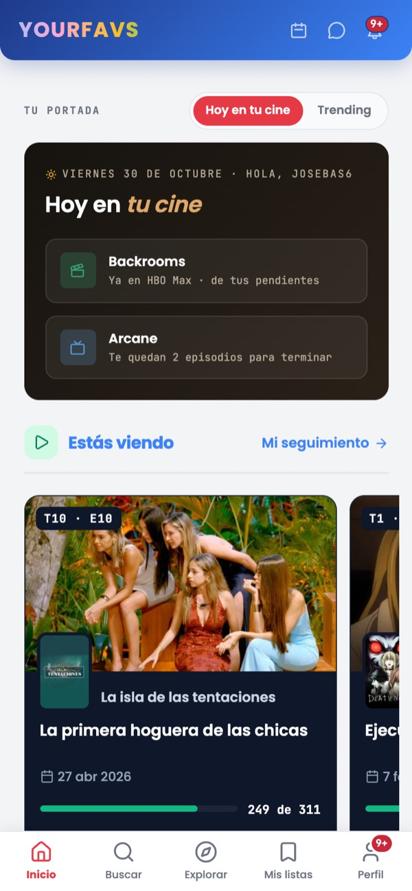
  </picture>
  <picture>
    <source media="(prefers-color-scheme: dark)" srcset=".github/readme/movil-serie-oscuro.jpg" />
    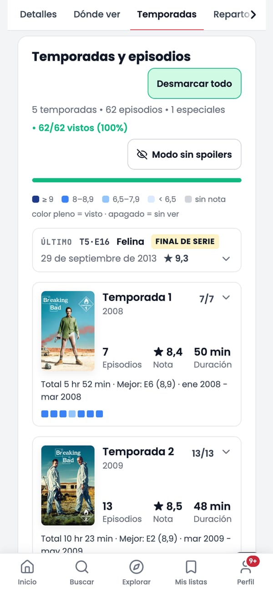
  </picture>
  <picture>
    <source media="(prefers-color-scheme: dark)" srcset=".github/readme/movil-episodio-oscuro.jpg" />
    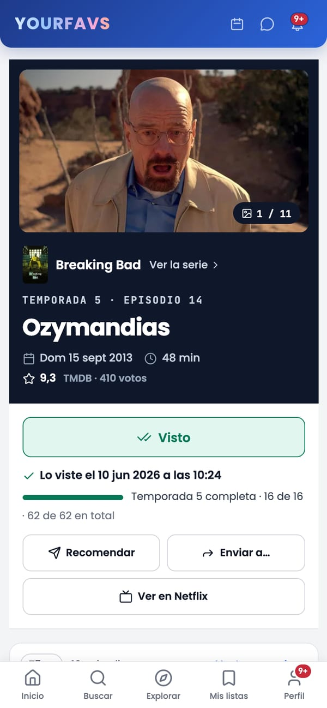
  </picture>

  <picture>
    <source media="(prefers-color-scheme: dark)" srcset=".github/readme/movil-mensajes-oscuro.jpg" />
    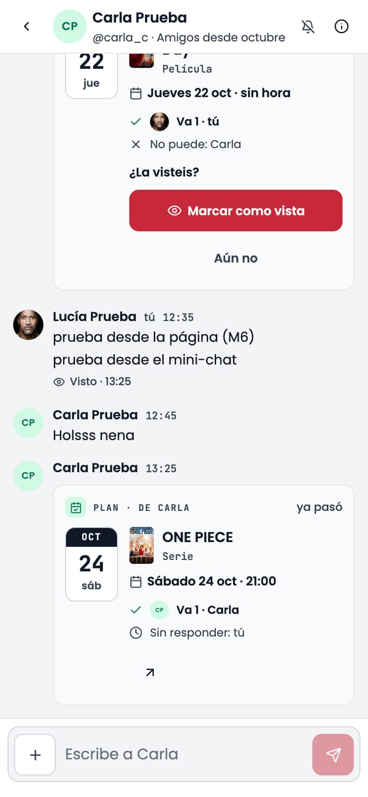
  </picture>
  <picture>
    <source media="(prefers-color-scheme: dark)" srcset=".github/readme/movil-favoritos-oscuro.jpg" />
    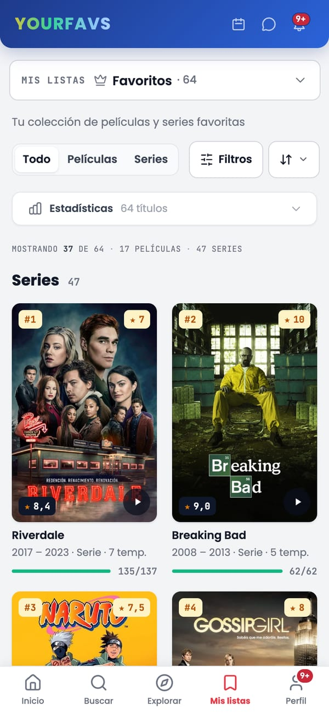
  </picture>
  <picture>
    <source media="(prefers-color-scheme: dark)" srcset=".github/readme/movil-tu-ano-oscuro.jpg" />
    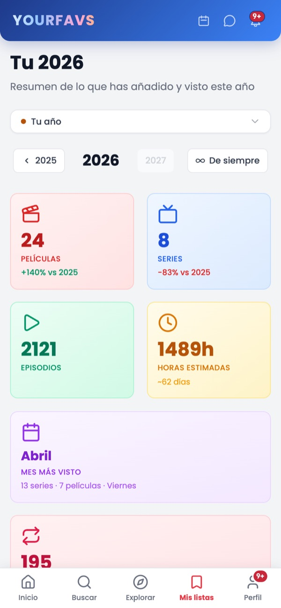
  </picture>

  <picture>
    <source media="(prefers-color-scheme: dark)" srcset=".github/readme/escritorio-pelicula-oscuro.jpg" />
    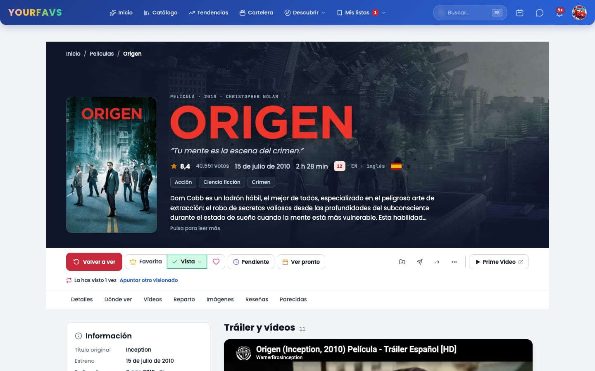
  </picture>

  <picture>
    <source media="(prefers-color-scheme: dark)" srcset=".github/readme/escritorio-actividad-oscuro.jpg" />
    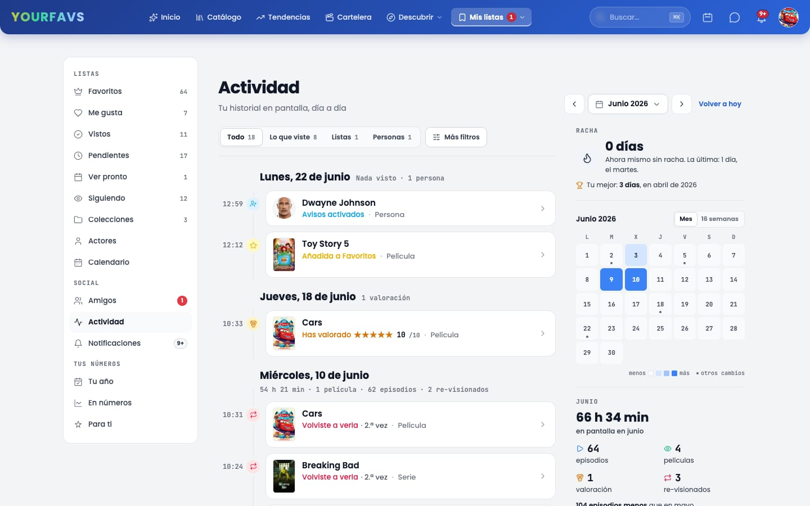
  </picture>

  <picture>
    <source media="(prefers-color-scheme: dark)" srcset=".github/readme/escritorio-catalogo-oscuro.jpg" />
    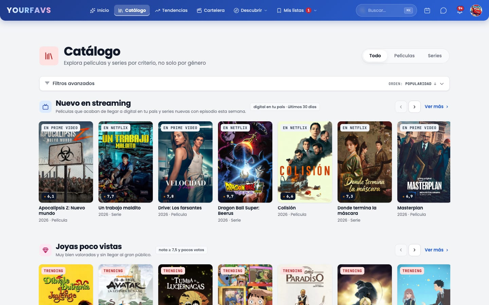
  </picture>

<b>Más pantallas</b>

 

  <picture>
    <source media="(prefers-color-scheme: dark)" srcset=".github/readme/escritorio-calendario-oscuro.jpg" />
    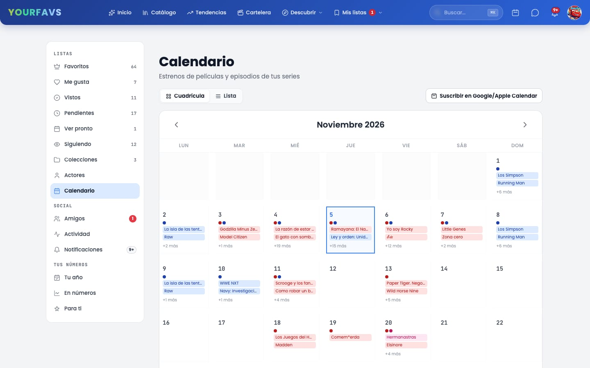
  </picture>
    
  <picture>
    <source media="(prefers-color-scheme: dark)" srcset=".github/readme/escritorio-importar-oscuro.jpg" />
    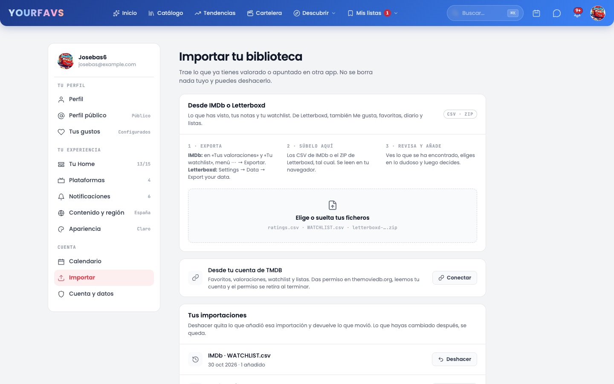
  </picture>
    
  <picture>
    <source media="(prefers-color-scheme: dark)" srcset=".github/readme/escritorio-perfil-publico-oscuro.jpg" />
    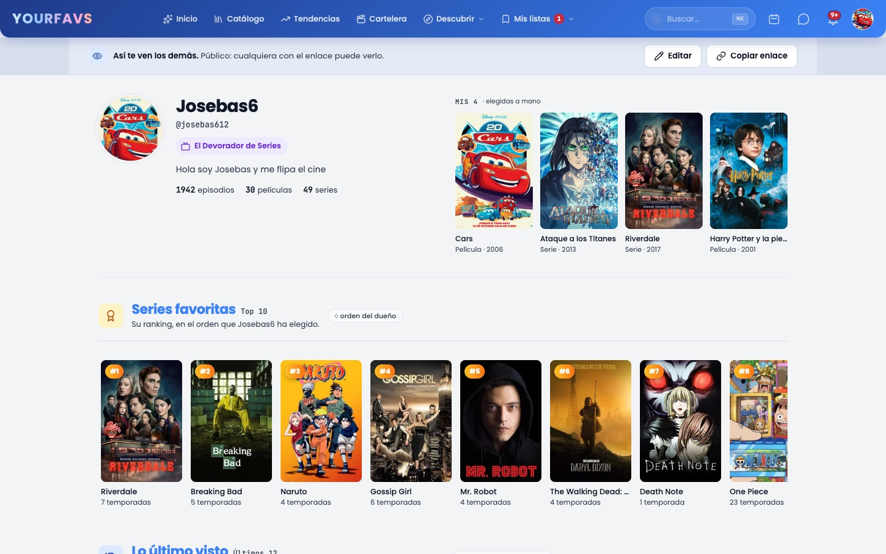
  </picture>

## Qué es

YourFavs empezó como una lista de películas favoritas y ha acabado siendo el sitio donde llevo todo
lo que veo: lo que he visto, lo que tengo a medias, lo que quiero ver y lo que me recomiendan mis
amigos. Sabe qué episodio te toca de cada serie, dónde se puede ver cada título en tu país, qué se
estrena este mes, y te deja quedar con un amigo para ver una peli desde el propio chat. Es una web
renderizada en el servidor que se instala como una app. Está en español; es la que uso a diario.

## Funciones

- 📺 **Episodio a episodio.** Marcas episodios desde la ficha de la serie, desde la ficha de cada
  episodio o desde «Estás viendo» en la portada, que siempre enseña el siguiente, con deshacer.
  Progreso por temporada y por serie, una tira de episodios coloreada por su nota (con seis paletas
  a elegir en Ajustes), finales y parones señalados, y un modo sin spoilers que oculta fotogramas y
  sinopsis de lo que no has visto.
- 🗂️ **Listas con sentido.** Favoritos (con tu propio ranking), Me gusta, Vistas, Pendientes, Ver
  pronto y Siguiendo, como niveles que nunca se contradicen, y además tus colecciones propias.
  Notas del 0,5 al 10, opiniones y un diario con cada vez que vuelves a ver algo.
- ✨ **Qué ver.** Un motor «Para ti» basado en tus notas, tus listas y tus géneros, con variedad y
  rotación diaria; filas curadas en el catálogo («Nuevo en streaming» marca lo que está en tus
  plataformas, «Hecho en España», «De Latinoamérica», joyas escondidas…), filtros avanzados y una
  ruleta «No sé qué ver» para las noches de indecisión.
- 🌍 **Dónde verlo.** Disponibilidad en plataformas por país y por temporada, tus plataformas
  primero, y la fecha de estreno en tu país junto a la mundial.
- 📅 **Calendario.** Estrenos y episodios de las series que sigues, por mes o en lista, y un feed
  `.ics` privado para suscribirte desde Google Calendar o el iPhone.
- 👥 **Con amigos.** Amigos y seguidos (por separado), perfil público, recomendaciones con
  respuestas rápidas, chats de dos y de grupo con tarjetas de títulos, «¿Qué vemos?» (una tirada
  entre lo que tenéis pendiente) y planes con fecha y quién va. Los avisos se quedan dentro de la
  app.
- 📥 **Trae tu biblioteca.** Importa desde IMDb (CSV), Letterboxd (ZIP: vistas, notas,
  pendientes, diario y listas) o una cuenta de TMDB, con un paso para revisar las coincidencias
  dudosas y deshacer con un clic.
- 🕒 **Tu actividad.** Una línea de tiempo de todo lo que haces, en su orden y por meses que se
  encadenan al bajar: lo que viste en tarjetas, los cambios de listas en una línea, el tiempo en
  pantalla de cada día, tu racha (solo cuentan los días en que viste algo), un calendario del mes,
  hitos («Tu episodio 2.100») y filtros que viajan en la URL.
- 📊 **Tu año.** Películas, series, episodios y horas por año, mes a mes, tu día de la semana más
  activo y una vista «de siempre».

## Lo técnico

- **Renderizado y datos en el servidor.** Astro 5 con SSR sobre Netlify Functions. El navegador
  no habla nunca con Supabase ni con TMDB: toda lectura y escritura pasa por el servidor con la
  sesión del usuario.
- **La seguridad, en la base de datos.** PostgreSQL en Supabase con Row Level Security en todas
  las tablas, y las reglas importantes (quién puede leer un chat, quién es amigo, qué enseña un
  perfil público) en SQL y cubiertas por **344 tests de pgTAP**. Cada cambio de esquema es una
  migración.
- **Tiempo real sin filtrar contenido.** Los mensajes y avisos llegan por Supabase Realtime en un
  canal por usuario cuyo nombre solo da el servidor. Por el canal solo viajan avisos vacíos («mira
  el chat 42»), nunca contenido; cada cliente se lo pide luego al servidor, así que siguen
  mandando las reglas de la base de datos.
- **TMDB, con cabeza.** Las fichas de película y serie hacían 30-40 llamadas cada una; con
  `append_to_response` ahora hacen 2-5 (medido con un contador de llamadas que solo funciona en
  desarrollo). Los detalles se guardan en Postgres exactamente el tiempo que el CDN de TMDB dice
  que siguen frescos (`Cache-Control: max-age`), nunca más, así que lo que se enseña es siempre lo
  último de TMDB. Las peticiones se autentican con un token Bearer y, si falla, pasan solas a la
  clave de API.
- **Un sistema de diseño, no un tema.** Un rediseño completo en nueve fases sobre tokens
  (tipografía, color, radios, sombras) y componentes compartidos (tarjeta de título, filas,
  cabeceras de sección, chips, cifras), en claro y en oscuro. Cada fase se diseñó en Claude Design,
  se contrastó con un inventario de lo que ya había para no perder ni un dato ni una función y se
  comprobó con una auditoría automática antes y después: las doce páginas más largas pasaron de
  267.405 a 84.354 px de alto en móvil (−68 %), y las clases de color de Tailwind escritas a mano,
  de 2.289 a 988.
- **Un service worker prudente.** Se instala como una app, pero el HTML no se guarda nunca en
  caché, porque cada página lleva la sesión del usuario. Solo se guardan los recursos con hash,
  los iconos y los pósters, cada uno con su estrategia.
- **De Firebase a Supabase.** La app empezó sobre Firestore y se migró a Postgres con un script
  de un solo uso, sin perder datos de nadie.
- **Las fechas, bien.** El servidor va en UTC, pero los días, meses y años se cuentan en la zona
  horaria del usuario: una peli vista a las 00:30 cuenta para el día que toca.

## Cómo trabajo

- **Un plan antes de cada lote.** Cada bloque de trabajo empieza como un plan escrito (el de
  TMDB, la capa social, los mensajes…) con sus pasos, sus decisiones y qué comprobar en cada uno.
  El plan sigue vivo: cada paso apunta su commit y cualquier desviación.
- **Diseño antes que código.** Las pantallas nuevas se diseñan primero con Claude Design, solo con
  los tokens que ya existen. Lo que el diseño no cubre se
  decide y se apunta, no se improvisa.
- **Pasos pequeños y comprobados.** Una rama por lote, un commit por paso, y nada se sube sin
  comprobarlo a la vista: chequeo de tipos y el cambio funcionando en un navegador de verdad, en
  claro y en oscuro, en escritorio y en móvil, comparando antes y después. Los lotes se unen a
  `develop` con `--no-ff` y `main` solo avanza con fast-forward.
- **Herramientas.** Además de las de siempre, uso asistentes de IA (Claude Code y Claude Design)
  para acelerar la implementación y las iteraciones de diseño, siempre dentro de los planes,
  reglas y comprobaciones de arriba.

### En números

| Commits | Páginas | Rutas de API | Migraciones | Tests de base de datos |
| :-----: | :-----: | :----------: | :---------: | :--------------------: |
|   422   |   48    |     118      |     27      |          344           |

## Stack

| Capa      | Tecnología                                                                           |
| --------- | ------------------------------------------------------------------------------------ |
| Front end | Astro 5 (SSR), TypeScript, Tailwind CSS con tokens de diseño, temas claro y oscuro   |
| Back end  | Netlify Functions, Netlify Blobs para cachés compartidas                              |
| Datos     | Supabase: PostgreSQL con RLS, Auth, Realtime y Storage                                |
| Contenido | API de TMDB (películas, series, personas; disponibilidad de JustWatch)                |
| App       | PWA con service worker propio, manifest y feed de calendario `.ics` privado          |
| Calidad   | pgTAP, chequeo de tipos de TypeScript, comprobaciones en Chrome sin interfaz (Puppeteer) |

---

Más sobre este proyecto y el resto de mi trabajo en mi portfolio: [franbasguil.netlify.app](https://franbasguil.netlify.app/es/proyectos/yourfavs/)

---

  Este producto usa la API de TMDB pero no está avalado ni certificado por TMDB. Disponibilidad en plataformas por JustWatch.

