

  

<h1 align="center">YourFavs</h1>

  <b>Everything you watch, in one place.</b> 
  A web app to track the films and series you watch, episode by episode, find what to watch next
  and share it with your friends.

  <b>English</b> · <a href="README.es.md">Español</a> · <a href="https://yourfavs.netlify.app/">yourfavs.netlify.app</a>

  
  
  
  
  
  
  

  <picture>
    <source media="(prefers-color-scheme: dark)" srcset=".github/readme/movil-portada-oscuro.jpg" />
    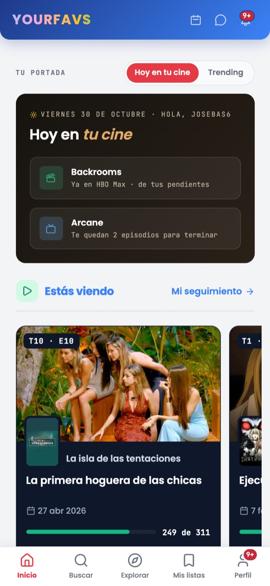
  </picture>
  <picture>
    <source media="(prefers-color-scheme: dark)" srcset=".github/readme/movil-serie-oscuro.jpg" />
    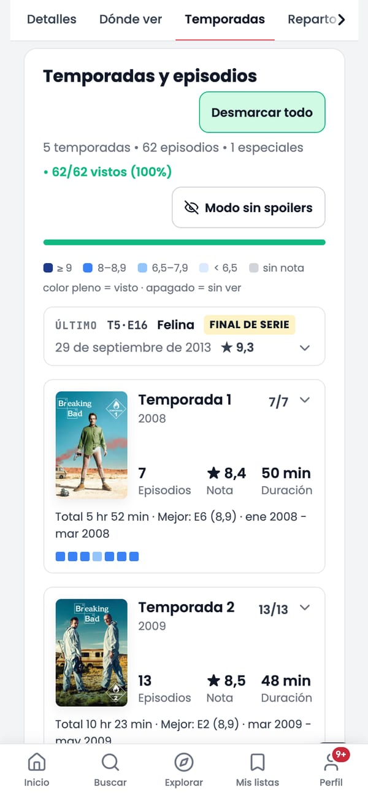
  </picture>
  <picture>
    <source media="(prefers-color-scheme: dark)" srcset=".github/readme/movil-episodio-oscuro.jpg" />
    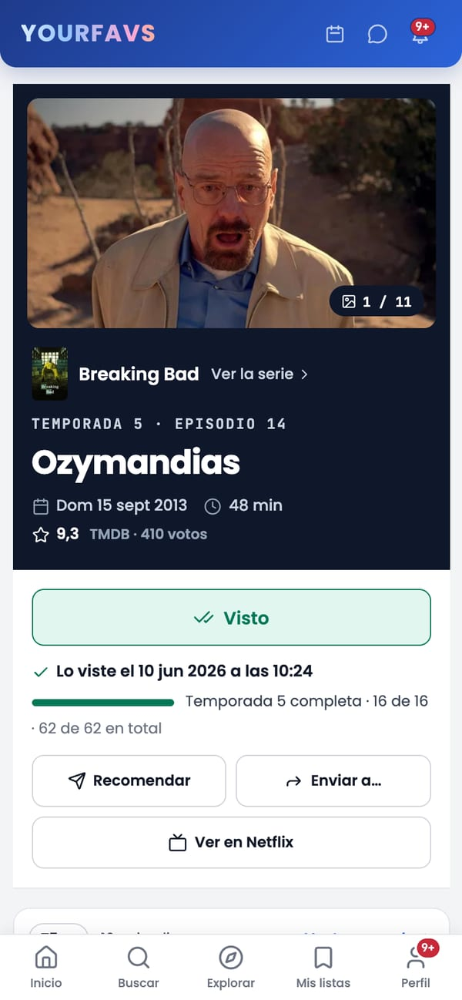
  </picture>

  <picture>
    <source media="(prefers-color-scheme: dark)" srcset=".github/readme/movil-mensajes-oscuro.jpg" />
    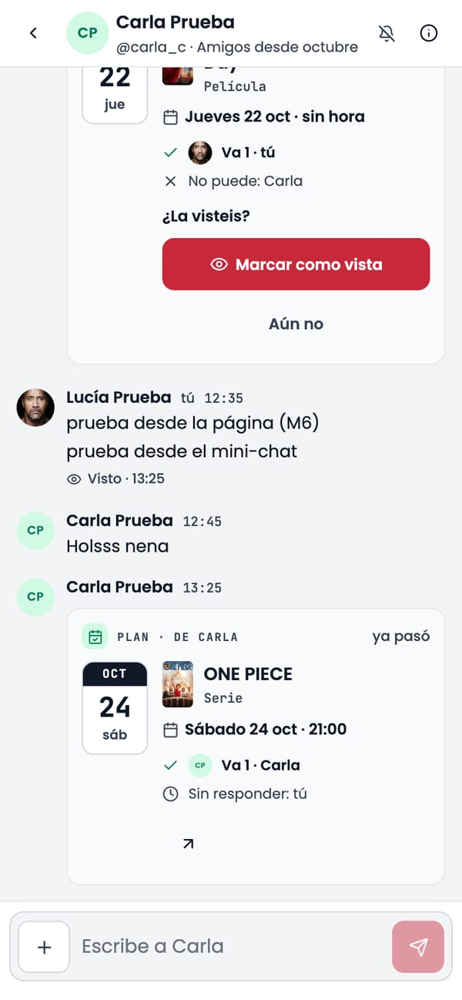
  </picture>
  <picture>
    <source media="(prefers-color-scheme: dark)" srcset=".github/readme/movil-favoritos-oscuro.jpg" />
    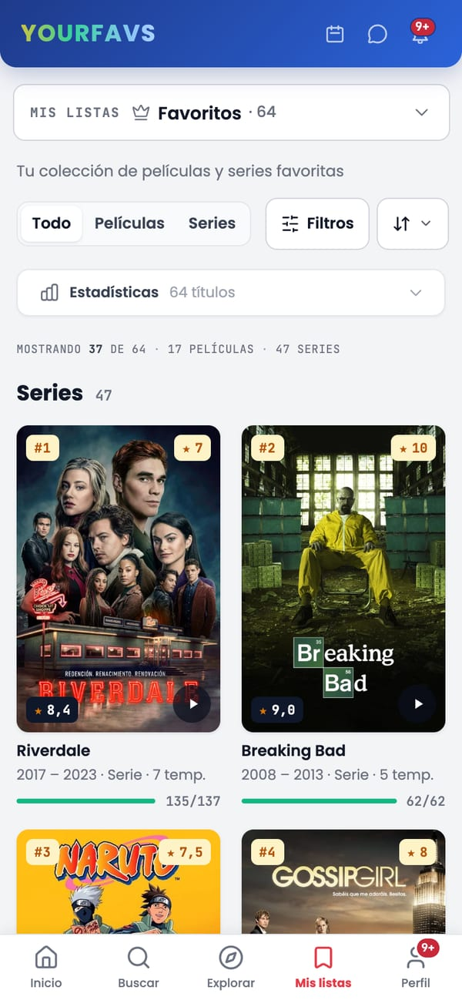
  </picture>
  <picture>
    <source media="(prefers-color-scheme: dark)" srcset=".github/readme/movil-tu-ano-oscuro.jpg" />
    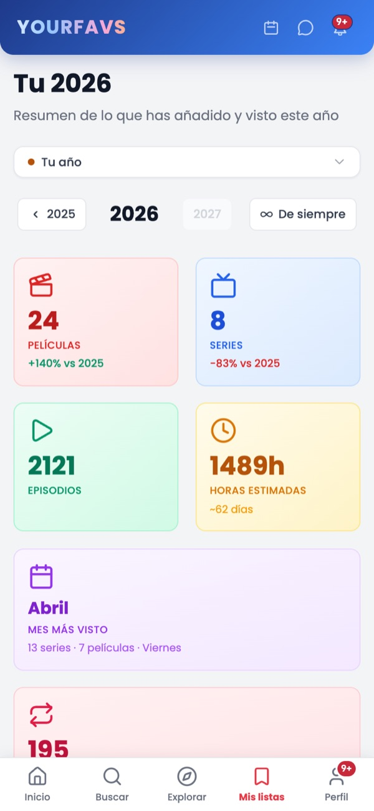
  </picture>

  <picture>
    <source media="(prefers-color-scheme: dark)" srcset=".github/readme/escritorio-pelicula-oscuro.jpg" />
    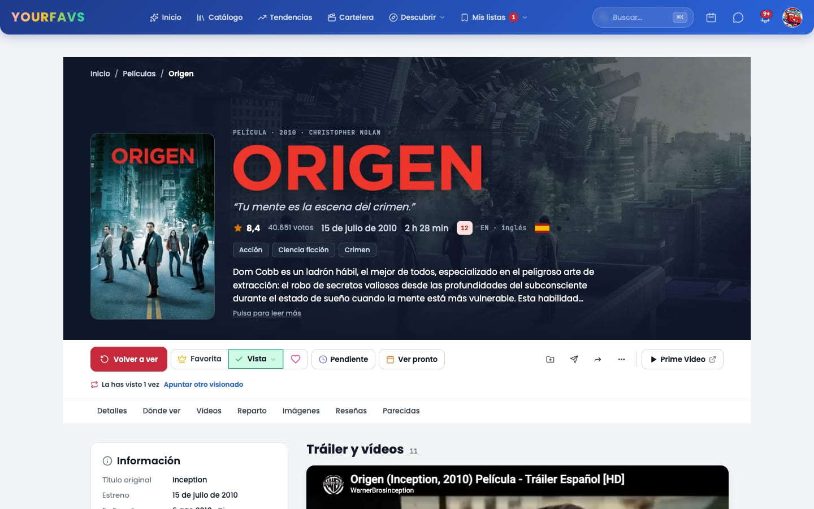
  </picture>

  <picture>
    <source media="(prefers-color-scheme: dark)" srcset=".github/readme/escritorio-catalogo-oscuro.jpg" />
    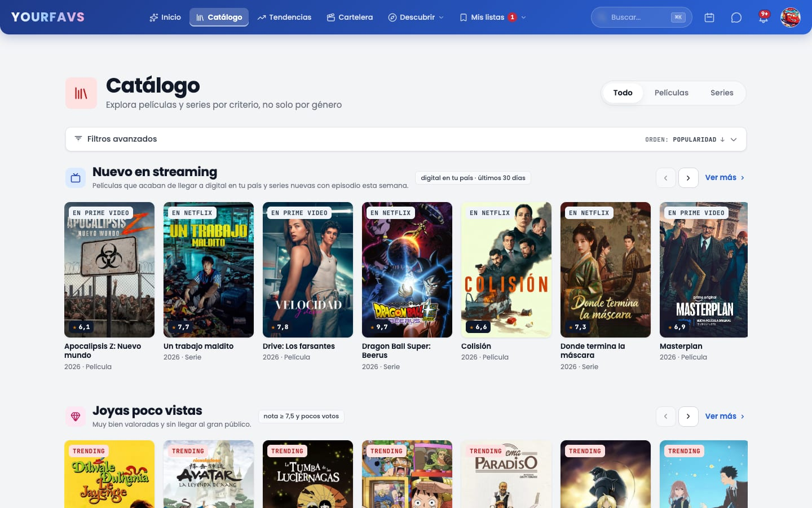
  </picture>

<b>More screens</b>

 

  <picture>
    <source media="(prefers-color-scheme: dark)" srcset=".github/readme/escritorio-calendario-oscuro.jpg" />
    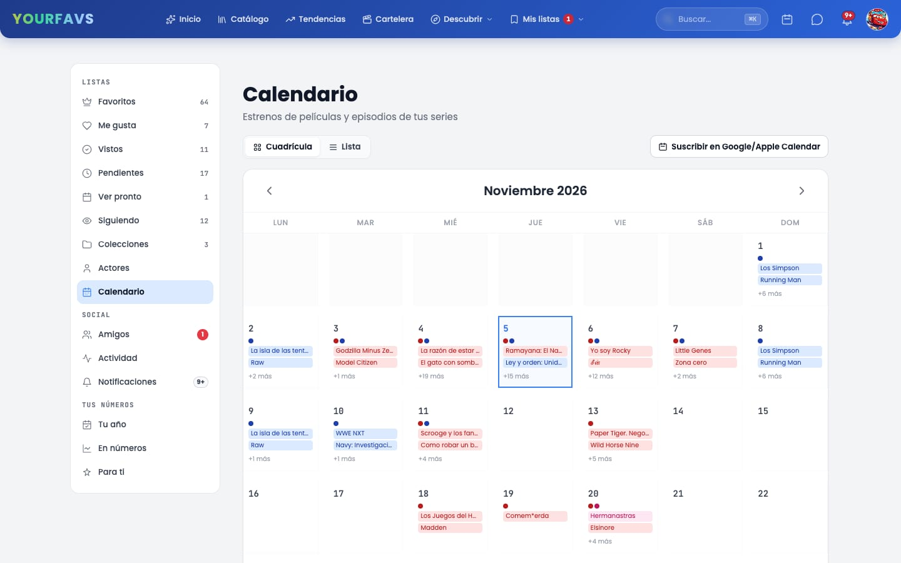
  </picture>
    
  <picture>
    <source media="(prefers-color-scheme: dark)" srcset=".github/readme/escritorio-importar-oscuro.jpg" />
    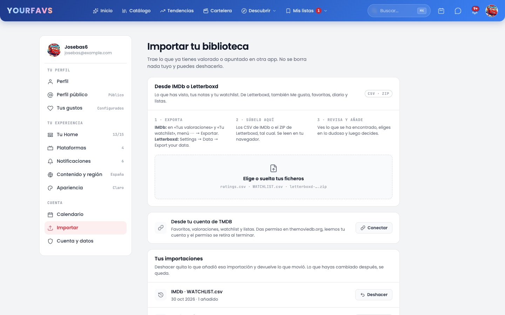
  </picture>
    
  <picture>
    <source media="(prefers-color-scheme: dark)" srcset=".github/readme/escritorio-perfil-publico-oscuro.jpg" />
    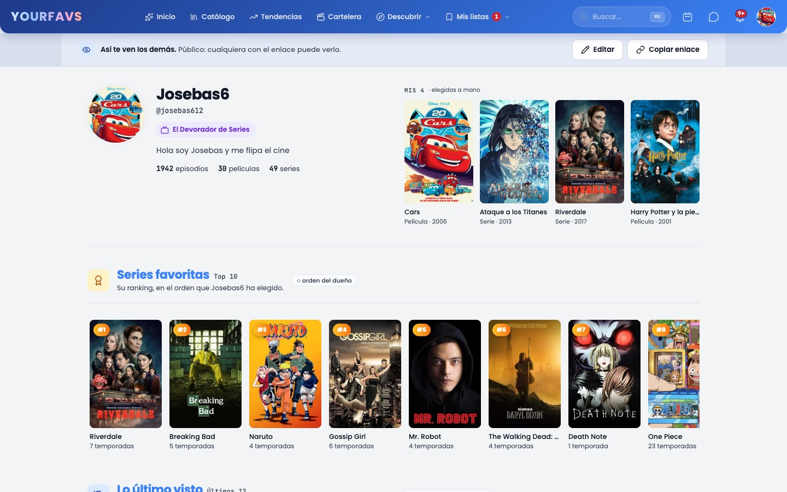
  </picture>

## What it is

YourFavs started as a list of favourite films and grew into the place where I keep everything I
watch: what I have seen, what I am halfway through, what I want to see and what my friends
recommend. It knows which episode comes next in each series, where each title can be watched in
your country, what premieres this month, and it lets you plan a film night with a friend from a
chat. It is a server-rendered web app that installs like a native one. The interface is in
Spanish; it is the one I use every day.

## Features

- 📺 **Episode by episode.** Mark episodes as watched from the series page, from each episode's
  own page or from «You're watching» on the home page, which always shows the next one, with an
  undo. Progress per season and per series, finales and mid-season breaks flagged, and a
  spoiler-free mode that hides stills and synopses of what you have not seen.
- 🗂️ **Lists that mean something.** Favourites (with your own ranking), Liked, Watched, Watchlist,
  Watch soon and Following, as levels that never contradict each other, plus your own
  collections. Ratings from 0.5 to 10, notes and a diary with every rewatch.
- ✨ **What to watch.** A «For you» engine built on your ratings, your lists and your genres, with
  variety and daily rotation; curated catalogue rows («New on streaming» marks what is on your
  platforms, «Made in Spain», «From Latin America», hidden gems…), advanced filters and an «I don't
  know what to watch» roulette for undecided nights.
- 🌍 **Where to watch it.** Streaming availability per country and per season, your platforms
  first, and the release date in your country next to the worldwide one.
- 📅 **Calendar.** Premieres and the episodes of the series you follow, by month or as a list,
  and a private `.ics` feed to subscribe from Google Calendar or the iPhone.
- 👥 **With friends.** Friends and follows (kept apart), a public profile, recommendations with
  quick replies, one-to-one and group chats with title cards, «What shall we watch?» (a roll
  among what you all have pending) and plans with a date and RSVPs. Notifications stay inside the
  app.
- 📥 **Bring your library.** Import from IMDb (CSV), Letterboxd (ZIP: watched, ratings,
  watchlist, diary and lists) or a TMDB account, with a review step for doubtful matches and a
  one-click undo.
- 📊 **Your year.** Films, series, episodes and hours per year, month by month, your busiest day
  and an all-time view.

## Technical highlights

- **Server-rendered, server-only data.** Astro 5 with SSR on Netlify Functions. The browser never
  talks to Supabase or TMDB: every read and write goes through the server with the user's
  session.
- **Security in the database.** PostgreSQL on Supabase with Row Level Security on every table,
  and the rules that matter (who can read a chat, who is a friend, what a public profile shows)
  enforced in SQL and covered by **344 pgTAP tests**. Every schema change is a migration.
- **Real time without leaking content.** Messages and notifications arrive through Supabase
  Realtime on a per-user channel whose name only the server hands out. The channel carries empty
  pings («look at chat 42»), never content; each client then asks the server, so the database
  rules still decide.
- **TMDB, the efficient way.** Film and series pages used to make 30–40 calls each; with
  `append_to_response` they now make 2–5 (measured with a call meter that only runs in
  development). Details are cached in Postgres for exactly as long as TMDB's CDN says they are
  fresh (`Cache-Control: max-age`), never longer, so the data shown is always TMDB's latest.
  Requests authenticate with a Bearer token and fall back to the API key on their own.
- **A careful service worker.** It installs as an app, but HTML is never cached, because every page
  carries the user's session. Only hashed assets, icons and posters are, each with its own
  strategy.
- **From Firebase to Supabase.** The app started on Firestore and was migrated to Postgres with a
  one-off script, without losing user data.
- **Dates done right.** The server runs in UTC, while days, months and years are counted in the
  user's time zone, so a film watched at 00:30 counts for the right day.

## How I work

- **A plan before each batch.** Every block of work starts as a written plan (the TMDB one, the
  social layer, messages…) with steps, decisions and what to check in each. The plan stays alive:
  each step records its commit and any deviation.
- **Design before code.** New screens are designed first with Claude Design, using only the
  existing tokens. Whatever the design does not cover is decided and
  written down, not improvised.
- **Small, verified steps.** One branch per batch, one commit per step, and nothing is committed
  without a visual check: type check, then the change running in a real browser, light and dark,
  desktop and mobile, compared before and after. Batches are merged into `develop` with
  `--no-ff`, and `main` only moves forward by fast-forward.
- **Tools.** Besides the usual ones, I use AI assistants (Claude Code and Claude Design) to speed
  up implementation and design iterations, always within the plans, rules and checks above.

### By the numbers

| Commits | Pages | API routes | Migrations | Database tests |
| :-----: | :---: | :--------: | :--------: | :------------: |
|   327   |  48   |    113     |     23     |      344       |

## Tech stack

| Layer     | Technology                                                                          |
| --------- | ----------------------------------------------------------------------------------- |
| Front end | Astro 5 (SSR), TypeScript, Tailwind CSS with design tokens, light and dark themes    |
| Back end  | Netlify Functions, Netlify Blobs for shared caches                                   |
| Data      | Supabase: PostgreSQL with RLS, Auth, Realtime and Storage                            |
| Content   | TMDB API (films, series, people, availability by JustWatch)                          |
| App       | PWA with its own service worker, web manifest and private `.ics` calendar feed      |
| Quality   | pgTAP, TypeScript type checking, browser checks with headless Chrome (Puppeteer)    |

---

  This product uses the TMDB API but is not endorsed or certified by TMDB. Streaming availability by JustWatch.

